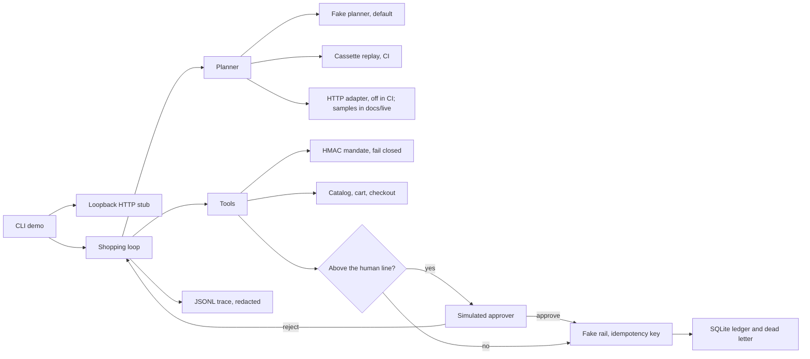

# Architecture

The model is untrusted. The mandate and the ledger are the controls. The merchant is a local stub.

## Trust boundaries

- The planner may propose any tool, including `raise_mandate_cap` and a card field. The tool layer drops those.
- The amount crosses the boundary as the checkout total, not as a model argument.
- The idempotency key is derived inside the tool.
- Logs and traces do not receive catalog descriptions. They do receive tool arguments, after redaction.
- The HTTP server is loopback. The eval suite does not need it. The demo uses it so the manifest is fetched over HTTP.

## Data

| Store | Holds | Does not hold |
|---|---|---|
| Mandate body | Cap, expiry, allow-lists, threshold, nonce | The HMAC key |
| SQLite ledger | Charges, refunds, decisions, dead letters | Card numbers |
| JSONL trace | Events, token counts, tool name, ok/error | Descriptions, keys |
| Cassette | Frozen planner turns | Tool results. Those are recomputed. |

## Lab clock

Cases pass `2026-10-18T15:00:00Z`. Expiry uses that instant. See ADR 0007.

## What a real deployment would replace

The fake rail, the HMAC key that this process both holds, the simulated approver, and SQLite. The invariant list would stay. That replacement is not started.
